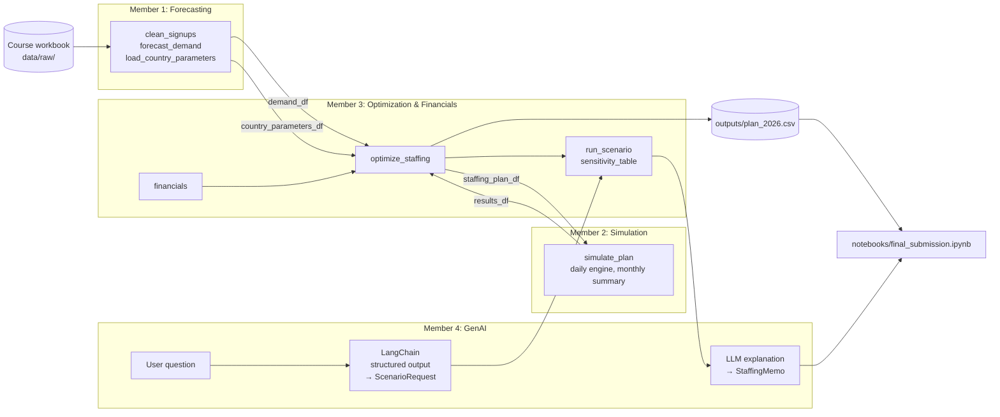

# Architecture

## Course techniques used (need at least two)

| Technique | Where |
|---|---|
| LangChain | `src/genai/assistant.py`: chains from parsing to tool call to explanation |
| Structured output | `ScenarioRequest` and `StaffingMemo` Pydantic models |
| Prompt engineering | `src/genai/prompts.py`: parsing and grounded-explanation prompts |
| *(optional)* Agents / tool calling | LLM chooses when to call `run_scenario` |
